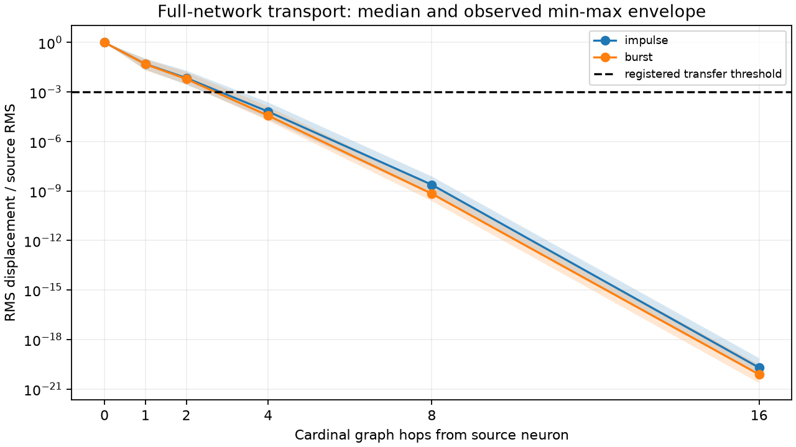
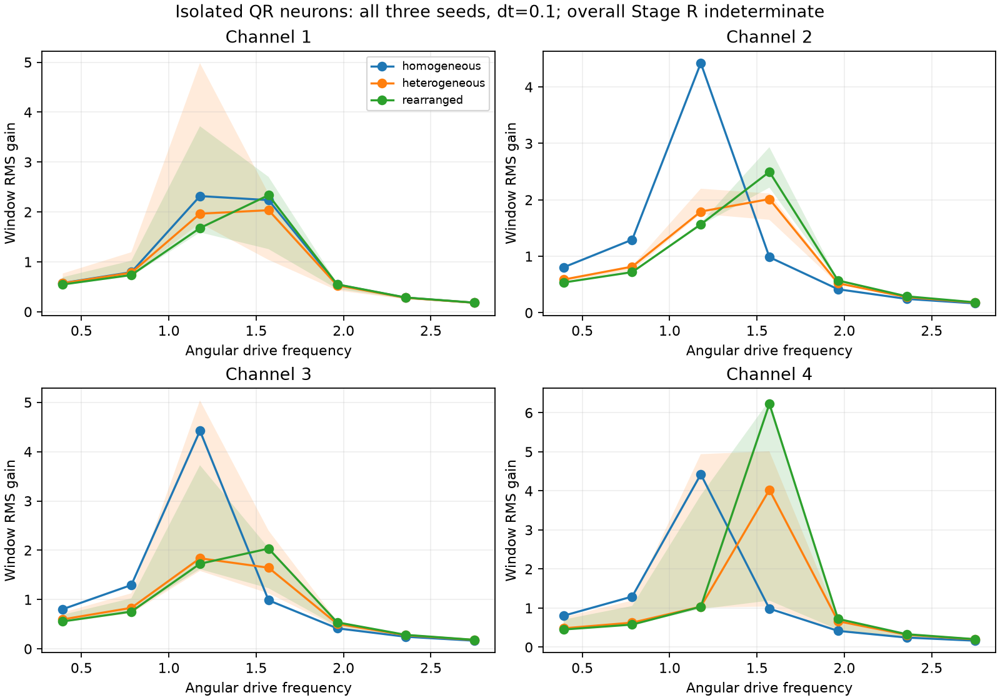

# Experiment 0002 — measured T/R results

Date: 2026-11-12. [Frozen registration](../EXPERIMENT_0002.md).
[Progression index](EXPERIMENTS.md). **Stage P was not run.**

## Outcomes

- **Stage T: negative under the registered four-hop usability criterion.**
  All 96 required observations crossed the absolute 1e-6 amplitude threshold,
  but none met the simultaneous RMS/source-RMS >=1e-3 transfer threshold.
  This is attenuated transmission, not absence of propagation.
- **Stage R: indeterminate under the registered numerical-validity criteria.**
  28/36 isolated-neuron sweeps met the resolved-peak criterion; 11/12
  same-histogram shape pairs exceeded 5% gain-curve difference on the primary
  grid. Four isolated-neuron timestep comparisons exceeded the 10% complex
  transfer tolerance. Three limited full-network comparisons met their 15% bound.
  Even without the convergence issue, the all-sweeps/all-pairs positive criterion
  was not met. No thresholds or parameter choices were revised after inspection.
- All 1,101 scheduled cases were accounted for in each of two runs: **73 T and
  1,028 R**. Every-step amplitude/velocity bounds passed, with no nonfinite values.
  Both zero-drive controls remained exactly zero; all persistent structures
  remained unchanged, as required with plasticity disabled.

These results concern a finite, deliberately constructed linear oscillator model.
They do not establish learning, associative memory, resilience, novelty, biological
resonance, subjective qualities, or reproducible unexpected/emergent computation.

## Chronology, preservation, and independent evidence

The registration draft clock is 2026-11-12 16:32:35 UTC. Its exact frozen Git
checkpoint is `f3167f19a2504c24e53fddc76a35423bf8ecc18d`, committed at
**16:38:24 UTC**, before implementation and trial collection. The separate
[proposal archive](EXPERIMENT_0002_PROPOSAL.md) normalizes trailing whitespace;
the actual authorized scope and numerical design are in the registration.
No physics, seed, threshold, or trial-schedule amendments were made after outcomes.

Raw runs are local and ignored by Git:

- `results/experiment_0002-a`
- `results/experiment_0002-b`

Complete directories compared byte-for-byte equal, including independently
calculated analysis outputs. Each includes exact engine source, registration,
proposal, parameters, full trial ledger, source waveforms, per-timestep probe
traces/global diagnostics, before/after persistent arrays, final u/v snapshots,
spectra, response/transport summaries, and scientific decisions. Final u/v
snapshots store the driven channel as little-endian pairs per module; the other
three channels remain exactly zero under the declared independent-channel model.
Same-machine/toolchain identity is verified; cross-platform identity is not.

Python independently verified all exported probe metrics, phases, threshold
arrivals, final-state diagnostic totals, input energy, coverage and persistent
state preservation. It calculated spectra from post-step traces and applied the
frozen criteria. A `COMPLETE` marker means every case was attempted, not success.
The raw Rust summary SHA-256 is:
`cd67cccbe6c380dd0384e2b0d5751ef4137f36c62eab6de9f91081acc3c9598d`.

Experiment 0001's engine, runner, analyzer, analysis tests, specification and
results report match their original SHA-256 hashes, with an empty Git diff for
those files. Its negative results and raw evidence remain intact. The historical
impulse CSV was copied unchanged into each new run folder; it is not a matched
comparison and supplies no quantitative superiority claim for the new model.

## Stage T: local transmission and strong attenuation

All center-source cardinal observations are included below, pooling registered
seeds/channels and both stimuli (96 observations per distance). Source injection
is local, synchronous, and causal. Reported arrival is an operational threshold
crossing, not a physical wavefront speed or first mathematical nonzero.

| Graph hops | Peak amplitude range | RMS/source-RMS range | Reached 1e-6 |
|---|---|---|---|
| 1 | 2.242e-02–1.003e-01 | 2.050e-02–1.047e-01 | 96/96 |
| 2 | 2.849e-03–2.178e-02 | 2.772e-03–1.963e-02 | 96/96 |
| 4 | 2.442e-05–3.311e-04 | 1.787e-05–2.332e-04 | 96/96 |
| 8 | 4.407e-10–1.161e-08 | 2.458e-10–7.560e-09 | 0/96 |
| 16 | 6.308e-21–1.636e-19 | 2.320e-21–7.442e-20 | 0/96 |

Two-hop observations meet the same numerical thresholds descriptively, but the
registered Stage T decision is specifically at four hops. Do not relabel it a
positive four-hop result or substitute a nearer distance after seeing outcomes.
The strongest four-hop transfer is only about 0.000233, below the 0.001 criterion.
There is no injected measurement noise; these thresholds do not establish a
real-world signal-to-noise guarantee.



Curves show medians; bands are observed min/max over registered seeds/channels
and cardinal directions, not confidence intervals. Source-normalized RMS is
separate from the absolute-amplitude requirement. No phase or color decoding
criterion is inferred from this plot.

### Edge/corner and latency measurements

All valid cardinal four-hop observations, with no omitted failed locations:

| Source | Drive | Observations | RMS/source-RMS range | 1e-6 arrival-time range |
|---|---|---|---|---|
| center | impulse | 48 | 2.204e-05–2.332e-04 | 2.8–3.9 |
| center | burst | 48 | 1.787e-05–1.321e-04 | 4.3–5.9 |
| edge | impulse | 36 | 2.860e-05–1.766e-04 | 2.9–4.2 |
| edge | burst | 36 | 1.826e-05–9.995e-05 | 4.4–7.4 |
| corner | impulse | 24 | 2.288e-05–8.587e-05 | 3.2–6.3 |
| corner | burst | 24 | 1.111e-05–5.082e-05 | 4.9–7.9 |

The source's heterogeneous local configuration differs between locations, so
boundary and configuration effects are confounded here. These observations
must not be attributed solely to edge geometry. Cardinal/diagonal data, phases
and per-probe spectra are retained in the verified tables. Equal graph distance
in diagonal directions means a different Euclidean distance; no isotropy claim
is justified. Internal-module propagation is also recorded at Manhattan distances
1,2,8. In raw `probes.csv`, the internal `distance` field is that graph distance;
the independent `transport-verified.csv` explicitly derives Euclidean distance
from module coordinates (including sqrt(32) for module 63), avoiding mixed-unit
interpretation. External distances were independently checked against coordinates.

## Stage R: spectral selectivity and its limits

Each baseline sweep contains seven energy-matched tones over a fixed 64-unit
window, with the first 32 units excluded from primary gain and phase metrics.
Equal energy and nominal tone amplitude are enforced. The maximum input-energy
error across all cases is **4.22e-15**. This normalization occurs in the external
forcing schedule, not as a hidden gain operation on neuron state.



All three registered seeds are included: lines are pointwise medians, bands
observed min/max. Homogeneous controls are identical across seeds, not three
independent heterogeneous samples. The plot uses primary dt=0.1; its visible
peaks do not override convergence failures or the frozen selectivity criteria.

### All isolated-neuron peak decisions

A resolved peak must be interior, beat both adjacent gains by 20%, and beat the
lowest off-frequency gain by 2×. All 36 primary sweeps have interior maxima;
eight fail the amplitude-selectivity margins rather than hitting a sweep edge.

| Seed | Configuration | Channel | Peak bin | Peak gain | Resolved | Half-step valid |
|---|---|---|---|---|---|---|
| 7 | homogeneous | 1 | 12 | 2.318108 | False | True |
| 7 | homogeneous | 2 | 12 | 4.422901 | True | True |
| 7 | homogeneous | 3 | 12 | 4.422901 | True | True |
| 7 | homogeneous | 4 | 12 | 4.422901 | True | True |
| 7 | heterogeneous | 1 | 12 | 4.982651 | True | True |
| 7 | heterogeneous | 2 | 12 | 2.197618 | False | True |
| 7 | heterogeneous | 3 | 12 | 5.040325 | True | True |
| 7 | heterogeneous | 4 | 12 | 4.939005 | True | True |
| 7 | rearranged | 1 | 12 | 3.717393 | True | True |
| 7 | rearranged | 2 | 16 | 2.933439 | True | True |
| 7 | rearranged | 3 | 12 | 3.724820 | True | True |
| 7 | rearranged | 4 | 12 | 3.886093 | True | True |
| 19 | homogeneous | 1 | 12 | 2.318108 | False | True |
| 19 | homogeneous | 2 | 12 | 4.422901 | True | True |
| 19 | homogeneous | 3 | 12 | 4.422901 | True | True |
| 19 | homogeneous | 4 | 12 | 4.422901 | True | True |
| 19 | heterogeneous | 1 | 16 | 2.035380 | False | True |
| 19 | heterogeneous | 2 | 12 | 1.792583 | False | True |
| 19 | heterogeneous | 3 | 12 | 1.837039 | False | True |
| 19 | heterogeneous | 4 | 16 | 5.013812 | True | False |
| 19 | rearranged | 1 | 16 | 2.702580 | True | True |
| 19 | rearranged | 2 | 16 | 2.216650 | True | True |
| 19 | rearranged | 3 | 16 | 2.033939 | True | True |
| 19 | rearranged | 4 | 16 | 6.315799 | True | False |
| 41 | homogeneous | 1 | 12 | 2.318108 | False | True |
| 41 | homogeneous | 2 | 12 | 4.422901 | True | True |
| 41 | homogeneous | 3 | 12 | 4.422901 | True | True |
| 41 | homogeneous | 4 | 12 | 4.422901 | True | True |
| 41 | heterogeneous | 1 | 16 | 2.366288 | True | True |
| 41 | heterogeneous | 2 | 16 | 2.112745 | True | True |
| 41 | heterogeneous | 3 | 16 | 2.398863 | True | True |
| 41 | heterogeneous | 4 | 16 | 4.026627 | True | False |
| 41 | rearranged | 1 | 16 | 2.336379 | True | True |
| 41 | rearranged | 2 | 16 | 2.496736 | True | True |
| 41 | rearranged | 3 | 16 | 2.046921 | False | True |
| 41 | rearranged | 4 | 16 | 6.225696 | True | False |

Scalar-module and nine-neuron coupled-patch curves were also measured for every
seed/configuration/channel. The patch consists of nine separate 8 × 8 neurons;
it is not a nine-module neuron or a substitute for the full transport network.
Full-network spectral cases are explicitly limited to heterogeneous seed 7,
channel 1. All curves, phases and parameters are in `responses-verified.csv`.

### Shape sensitivity with fixed histogram and fixed drive-module color

Relative L2 uses the original heterogeneous gain curve as denominator. This
compares full curves, not just a selected peak. The 5% criterion is primary-grid
sensitivity; paired numerical validity is stated separately.

| Seed | Channel | Relative gain-curve difference | Above 5% | Both curves converged |
|---|---|---|---|---|
| 7 | 1 | 0.244320 | True | True |
| 7 | 2 | 0.350149 | True | True |
| 7 | 3 | 0.246944 | True | True |
| 7 | 4 | 0.204038 | True | True |
| 19 | 1 | 0.252406 | True | True |
| 19 | 2 | 0.226719 | True | True |
| 19 | 3 | 0.166914 | True | True |
| 19 | 4 | 0.249482 | True | False |
| 41 | 1 | 0.032336 | False | True |
| 41 | 2 | 0.147528 | True | True |
| 41 | 3 | 0.124391 | True | True |
| 41 | 4 | 0.512256 | True | False |

Eleven pairs exceed 5% on the primary grid; nine of those also pass both paired
convergence checks. Seed 41/channel 1 differs by 3.23% and fails the registered
sensitivity margin. This is not a claim that its responses are identical.
Color and arrangement affect the declared coefficients by construction; the
experiment characterizes the resulting response, not unprogrammed emergence.

### Numerical convergence failures

All 36 isolated-neuron peak bins agree between dt=0.1 and dt=0.05. Nevertheless,
four complex transfer curves fail the 10% L2 error limit (denominator: finer-grid
complex-transfer norm). The other 32 pass; the full range is 7.00%–12.26%.

| Seed | Configuration | Channel | Relative complex error | Registered bound |
|---|---|---|---|---|
| 19 | heterogeneous | 4 | 0.117125 | 0.10 |
| 19 | rearranged | 4 | 0.122579 | 0.10 |
| 41 | heterogeneous | 4 | 0.102764 | 0.10 |
| 41 | rearranged | 4 | 0.122248 | 0.10 |

The three limited full-network half-step comparisons pass their 15% bound:

- Bin 8: relative complex error 0.039430.
- Bin 16: relative complex error 0.084992.
- Bin 24: relative complex error 0.118643.

Passing boundedness screens is distinct from convergence. No lower timestep or
finer frequency grid was substituted as the primary result after inspection.
This gives the overall Stage R **indeterminate** classification rather than a
certified positive resonance result.

### Damping, zero-input, and phase controls

Doubling damping in the registered isolated heterogeneous seed-7/channel-1
control lowers the maximum sampled gain from **4.982651 to 3.116634**. Zero-drive
cases produce exact zero displacement and velocity throughout. Matched-energy
multisine inputs have independently verified equal DFT magnitudes at bins
8,16,24 despite different phase assignments. Their measured RMS gains are
0.989720 (all-zero phases) and 0.985891 (seeded phases). This small finite-window
difference is not evidence of learned phase coherence or spatial synchronization.
The burn-in does not establish perfect asymptotic steady state; residual
transients remain a limitation and may contribute to sensitivity.

## Scope, limitations, and next falsification

- T/R have **no plasticity rule**, no eligibility memory, no target pattern and
  no persistent updates. All before/after arrays match; this supplies no Q4
  reconfiguration result and no evidence for R1 resilience or associative recall.
- The numerical model consists of linearly coupled damped oscillators for a
  fixed structure. Intrinsic response is not spontaneous autonomous activity
  from a zero state. No unanticipated observable was independently established.
- Input energy is a recorded sum(s² dt), not physical injected work, which
  depends on motion. Squared amplitude/velocity diagnostics are not claimed
  to be conserved physical energy.
- The three registered seeds and sparse frequency grid limit generality.
  Nine-neuron patches have their own zero-flux boundaries; full-network
  checks cover only one seed/channel. No global network signature is inferred
  from isolated-neuron curves.
- Coefficients are cached from fixed P at trial initialization. A future
  reconfiguration implementation must update those coefficients explicitly;
  none is silently changed by diagnostics or visualization.
- The historical 0001 reference has different dynamics/initial conditions and
  is not an equal-budget or matched-forcing benchmark. Its failure is unchanged.

Next, preregister timestep/frequency-resolution and longer-window sensitivity
checks plus a coupling/damping transport grid. Do not amend these failed or
indeterminate criteria retroactively. Stage P remains deferred and requires
separate authorization/registration after adequate diagnostic evidence.

## Reproduction and delivery evidence

Run from the project root with a fresh output path:

```sh
cargo run --locked --release --bin experiment_0002 -- results/my-experiment-0002
.venv/bin/python -m analysis.experiment_0002 results/my-experiment-0002
```

Optional scientific figures use the separately pinned plotting dependency:

```sh
.venv/bin/python -m pip install -r requirements-plot.txt
.venv/bin/python -m analysis.plot_experiment_0002 results/my-experiment-0002 docs/figures
```

The engine has no new Rust dependencies. Python numerical verification uses the
standard library. Local quality gates passed: 16 Rust tests, 8 Python tests,
formatting, strict Clippy and Ruff, release build, doctest execution, rustdoc
with warnings denied, Python compilation, documentation/figure links, independent
numerical verification, full-run byte comparison, and frozen Experiment 0001
preservation checks. Both figures were rendered and inspected.

Implementation checkpoint: `8a0f5b4`, following preregistration `f3167f1`.
Measured results and the progression index are delivered in a separate
documentation commit. Push and hosted CI status must be verified against the
delivered SHA; neither is a substitute for the measured scientific criteria.
