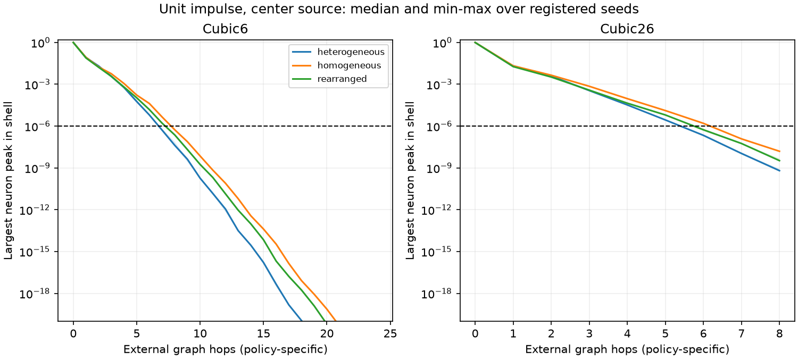
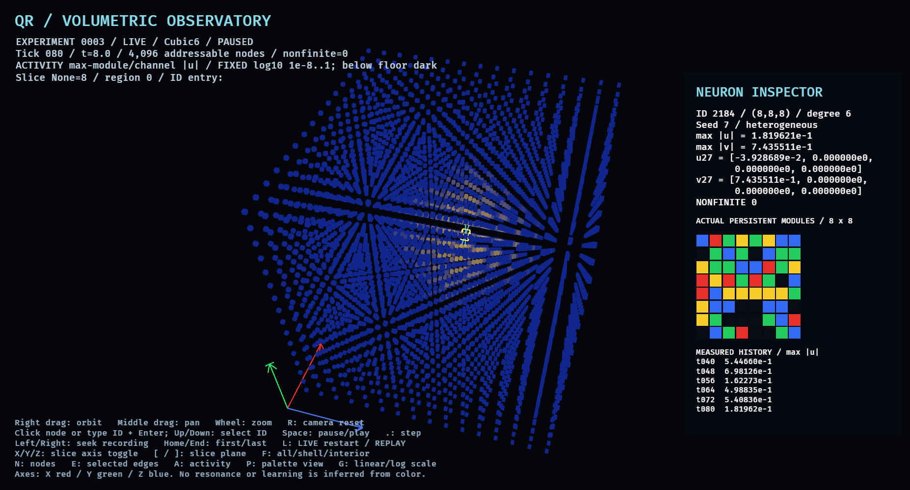
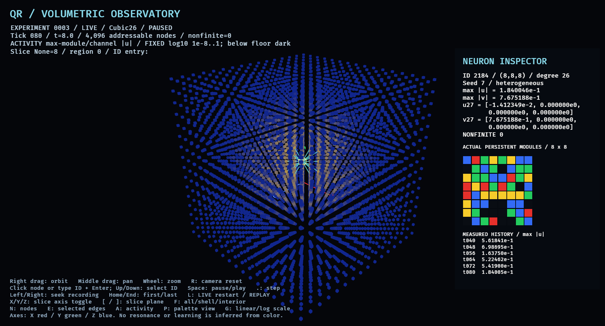

# Experiment 0003 — measured topology and observatory results

Measured 2026-11-13 UTC (2026-11-12 local session, America/Toronto).
**The deterministic volumetric engine, recording boundary, and native Bevy viewer
are implemented and verified within the bounded tests below. No learning,
resonance, associative memory, or resilience success is established.**

The [registration](../EXPERIMENT_0003.md) was frozen in
`5a112c14033f9a4a825b290b606d9ed1ca692a2d` at 2026-11-13 03:34:26 UTC,
before measurements. Implementation checkpoint:
`e9d9dcaea9ccbb168e3817be3af7706963a1ec73`. The separately archived
[proposal](EXPERIMENT_0003_PROPOSAL.md) contains an older checkout description;
Experiment 0002 was already implemented and measured when this work began.
Experiments 0001 and 0002 remain unchanged. Their negative T and indeterminate R
outcomes are not reclassified by this delivery.

## What ran and how it was checked

Two fresh runs, `results/experiment_0003-a` and `results/experiment_0003-b`,
each contain **111 cases**, 160 fixed steps per case, and **2,331 observation
frames** (ticks 0,8,…,160). Both directories compare byte-for-byte identical,
including independent analysis products, on this machine/toolchain (Rust 1.99.1).
This is not a cross-platform floating-point identity claim.

- 72 impulses: two cubic policies × three seeds × three configurations × four
  source locations. Initial module-27 displacement is 1; no subsequent forcing.
- 36 center-source tones: the same policies/seeds/configurations, at pi/4 and
  pi/2, sampled forcing energy 1 each.
- Two zero-drive controls and one preserved Grid2D8 regression fixture.
- All 111 scheduled cases completed. No every-step numerical screen failed;
  no nonfinite values, clipping, or persistent palette changes were observed.
  Both zero controls remained exactly zero. Inactive channels remained zero.

Rust decodes and checks the checksum of every exported frame. Independent Python
verification checks fields, palette invariance, geometry, condition coverage,
input energy, per-tick metrics and causal bounds across all frames/cases. Its
independent FNV checksum calculation samples **241 frames**: all 21 of case 0,
and first/last frames of the remaining 110 cases. This is distinct from the
core's checksum readback of all 2,331 frames. SHA-256 of the identical raw
`hashes.csv` ledgers:

`f6279047dd4015507a7851547bb82471b7a91cfc29c6999c7c530d0b07885ed1`

Raw data, sources, fixed registration copies, all-tick metrics, spatial
peak/arrival maps, degree/link tables, and completion markers remain under ignored
`results/`. A completion marker establishes execution, not a scientific success.

## T1/T2 — transport, boundaries and direction

Each of the 4,096 neurons owns an independent 8 × 8 persistent palette. The
16³ layout changes external neighbors; the configuration-dependent oscillator
and synchronous semi-implicit Euler rule are inherited from Experiment 0002.
Transient displacement/velocity is separate from persistent configuration.

| Policy | Degree histogram (degree: neuron count) | Undirected links by squared Euclidean length 1 / 2 / 3 |
|---|---|---|
| Cubic6 | 3:8, 4:168, 5:1176, 6:2744 | 11,520 / 0 / 0 |
| Cubic26 | 7:8, 11:168, 17:1176, 26:2744 | 11,520 / 21,600 / 13,500 |
| Grid2D8 | 3:4, 5:248, 8:3844 | 8,064 / 7,938 / 0 |

The external divisor is the **fixed maximum degree** 6, 26 or 8, not actual
local degree. Missing boundary links contribute nothing. Thus a Cubic6 corner
has 3/6 of the nominal link budget and a Cubic26 corner 7/26, before module
conductance factors. All existing links have the same nominal coefficient within
a policy; diagonal links are not reduced by length. This controls the interior
sum of nominal coupling, not every node's response or directional isotropy.

Threshold reach below means neuron max-module |u| ≥ 1e-6 at least once during
160 steps. Ranges cover all three seeds and all three configuration classes.
Uncrossed sites remain explicitly absent in arrival maps, rather than receiving
a fabricated final-tick arrival. All impulse global peaks were 1, including the
initial source. Remaining activity at time 16 is not a steady-state measurement.

| Policy | Source | Threshold-crossing neurons / 4096 | Furthest crossing (graph hops) | Final global peak range |
|---|---|---:|---|---|
| Cubic6 | Center (8,8,8) | 303–467 | 6–7 | 0.09430–0.21248 |
| Cubic6 | Corner (0,0,0) | 64–93 | 6–7 | 0.10215–0.22940 |
| Cubic6 | Face (0,8,8) | 178–274 | 6–7 | 0.07560–0.23022 |
| Cubic6 | Edge (0,0,8) | 98–160 | 6–7 | 0.09508–0.22231 |
| Cubic26 | Center (8,8,8) | 681–1153 | 5–6 | 0.13198–0.23228 |
| Cubic26 | Corner (0,0,0) | 109–178 | 4–5 | 0.10042–0.29787 |
| Cubic26 | Face (0,8,8) | 358–595 | 5–6 | 0.11142–0.23633 |
| Cubic26 | Edge (0,0,8) | 193–329 | 4–5 | 0.10833–0.24060 |

Graph hops and Euclidean distances are distinct. For homogeneous seed 7, center
impulse, the six axis offsets of length 2 agree within roundoff within each
policy: peak ≈0.00860818 (Cubic6) and ≈0.00449024 (Cubic26), crossing at tick 3.
A face-diagonal offset (1,1,0) has peak 0.01754063, tick 3, two hops in Cubic6;
in Cubic26 it has peak 0.02055744, tick 1, one hop. A body-diagonal (1,1,1)
has peak 0.00571804, tick 9, three hops in Cubic6, versus 0.02031937, tick 1,
one hop in Cubic26. Their Euclidean lengths remain sqrt(2) and sqrt(3).
These examples expose directional/path differences, not isotropy or physical
wave speed. Boundary placement, attenuation and finite observation time all
matter. No general boundary-reflection or long-time stability law was inferred.

The Grid2D8 reference crossed threshold at 126 neurons, furthest six hops.
It is a regression condition, not a matched-distance demonstration of 3D
superiority. The new adapter agrees bit-for-bit in u and v with existing 0002
raw data for 161 source ticks and 861 external-probe snapshot pairs. CI also
checks a small curated nine-tick legacy fixture. No old engine was edited.

## T4 — configuration dependence without plasticity

Center-impulse threshold-crossing counts, in seed order 7 / 19 / 41:

| Policy | Heterogeneous | Homogeneous all-red | Rearranged |
|---|---|---|---|
| Cubic6 | 303 / 308 / 305 | 467 / 467 / 467 | 377 / 368 / 364 |
| Cubic26 | 737 / 745 / 681 | 1153 / 1153 / 1153 | 951 / 902 / 921 |

Rearrangement preserves each neuron's palette histogram and source-module color
while changing spatial arrangement. The responses differ under the imposed
configuration-dependent coefficients. Homogeneous seeds are indistinguishable,
as expected because they generate identical palettes. All persistent bytes
remain unchanged: these are initial-condition comparisons, not adaptation.

The plot shows the largest per-neuron peak within each graph shell, with seed
median and min–max range. The dashed line is the registered threshold. Shell
maxima are not mean transfer or usable information capacity. Cubic26 graph
shells include diagonals; its horizontal distance cannot be treated as the same
physical separation as Cubic6. Broad attenuation remains evident in both.

## T3 — two forced-frequency probes

Both forcing frequencies use equal sampled input energy 1, dt=0.1, duration 16,
and only channel 1. Gain is source-module RMS divided by drive RMS during the
final time interval 8–16; phase is the finite-window sine/cosine projection.
Illustrative heterogeneous seed-7 center results:

| Policy | Angular frequency | Source gain | Source phase (radians) |
|---|---|---:|---:|
| Cubic6 | pi/4 | 0.789090 | 0.009289 |
| Cubic6 | pi/2 | 2.139465 | -2.438399 |
| Cubic26 | pi/4 | 0.776314 | -0.003680 |
| Cubic26 | pi/2 | 2.192442 | -2.422378 |

All 36 cases are retained in `case-summary.csv`, with all-tick metrics and
spatial maps. Frequency dependence exists for these defined forced equations.
Two samples and a transient finite window do not locate a resonant peak,
establish convergence, measure collective coherence, or repair Experiment
0002's failed convergence checks. No resonance success is claimed.
Squared amplitudes are diagnostic proxies, not conserved physical energy.

## T5/T6 — native instrument and replay evidence

The separate [Bevy operator guide](../viewer/README.md) documents launch,
controls, fixed scales, selection, playback and live stepping. Root physics has
no graphics dependency. Bevy's facade is pinned to 0.20.0; the separate lockfile
also pins its compatible component resolutions. No GPU simulation is used.

Final workstation receipts identify **AMD Ryzen 9 7950X 16-Core Processor
(RADV RAPHAEL_MENDOCINO)**, `IntegratedGpu`, Vulkan, `radv`,
`Mesa 26.2.6-arch1.1`. The window backend is X11 on this Wayland desktop
(XWayland), not evidence of a bare Xorg session. Default adapter preference is
low power, per the user's convention of reserving the RTX 5060 Ti for models.
Earlier successful native receipts on the NVIDIA RTX 5060 Ti/Vulkan remain
archived; the initial discrete-GPU selection prompted this preference change.

Automated real-window sessions completed in LIVE and REPLAY at both configured
30 and 60 frame caps, including alternate camera poses. The caps are maximum
rendering rates, not measured sustained FPS. Witnesses exercised pause/step,
normal fixed-update play, selection, overlays, slicing, and repeated seeks.
Each audited 67 rows: IDs 0, 2184 and 4095 across all 21 recorded ticks, plus
four repeated seeks. Exact whole-observation hashes, selected 64-byte palettes,
numeric fields and display-filter counts agreed with independent headless data.
The rendered panel's module color bindings and rounded numeric text bindings
were asserted; full-precision receipts remain separate from six-digit UI text.

Key ignored receipts:

- `results/0003-igpu-live-30`, `0003-igpu-live-60`: Cubic6 live at both caps.
- `results/0003-igpu-replay-30`, `0003-igpu-replay-60`: replay at both caps.
- `results/0003-igpu-live-60-final`, `0003-igpu-replay-30-final`: final-build Cubic6 checks.
- `results/0003-igpu-c26`, `0003-igpu-c26-live-final`: Cubic26 replay and live.
- `results/0003-igpu-synthetic`: explicitly labeled synthetic display-copy
  fixture. It injects a nonfinite **flag**, not an actual measured engine NaN.
  Independent verification expects this exact copied-byte difference.

Replay startup instantiates zero engines; seeking is snapshot lookup and drops
an existing live engine. LIVE uses the same CPU engine as headless execution;
render delta, selection, camera and color scales do not enter its update.
Deliberately flipping byte 300 in a saved snapshot caused exit 1 before
engine/window startup, with `snapshot checksum mismatch`. Version/length/order
errors are also checked in code/unit tests. No silent recovery was substituted.

These are automated native checks and inspected screenshots, not exhaustive
human mouse/keyboard usability testing. No FPS or GPU-performance benchmark
was run. Camera/picking ergonomics remain open to normal use.

These are unedited native captures. The false-color activity overlay has fixed
log10 bounds 1e-8–1; the inspector separately shows actual persistent modules.
Colors and visible patterns are instrument output, not memory evidence.

## Acceptance gates, limitations and next step

- **A geometry:** exhaustive ID/coordinate, unique reciprocal neighbor and
  boundary-degree tests passed for all three policies. Independent per-neuron
  palette mutation and ownership are tested.
- **B numerical/causal:** traversal-order invariance, graph-causal bounds,
  transient reset with persistent retention, legacy regression and bounded
  every-step screens passed. These are finite-run checks, not universal stability.
- **C viewer:** native launch, 4,096 addressable glyphs, actual 8 × 8 panel,
  tick/scale/source labels, filters, live/replay equality and corruption rejection
  passed within the automated scope described above.
- **D reproducibility:** two complete suites match byte-for-byte; all local
  quality gates passed: 21 root Rust tests, 10 Python tests, one isolated viewer
  test, strict Clippy/Ruff, formatting, root release build, doctests, rustdoc
  with warnings denied, Python compilation and native viewer build. Hosted
  delivery is recorded separately in `HANDOFF.md` and commit-specific CI.

Protected source/specification/results files for 0001/0002 passed their original
SHA-256 preservation receipt; Git shows no changes to those experiments. No
scientific registration was amended after observing results.

Observation files contain derived per-neuron peaks and signed module-27 u/v,
not all module displacements/velocities. They support exact observation replay,
not arbitrary dynamical checkpoint restart. L restarts the seeded fixture at
zero time explicitly. Recording is bounded (21 frames here; reader limit 256).
Display slices hide glyphs; they never disable neurons or constitute lesion tests.

The next scientific step requires a **new registration**: resolve time-step and
window convergence and quantify transport across matched graph/Euclidean probes
before introducing plasticity. R1 remains untested because intact learned
retrieval has not been demonstrated. Nothing in this report authorizes tuning
the frozen earlier experiments or inferring a memory mechanism from motion.
