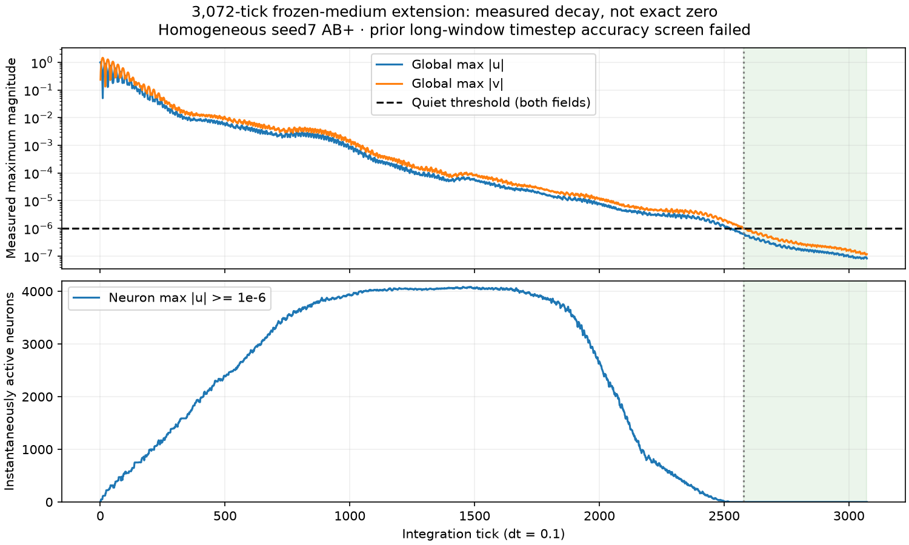

# Cube experiment report: 3,072-tick frozen-medium decay

## Read this first

Both global maxima remain below 1e-6 from tick **2579** through 3072: **494 consecutive ticks**.
Final max|u|=8.135888521015e-08; final max|v|=1.176935816520e-07.
Exact-zero status: **False**. The 128-tick sustained-quiet criterion
is **met**. This describes the defined discrete simulation, not a proof
of information erasure, physical accuracy, general stability, or learned memory.

The original dt 0.1/dt 0.05 study failed all 8 long-window accuracy comparisons;
the homogeneous AB+ comparison reached 29.085% relative L2 disagreement at
physical time 102.4. **No new convergence test was run at time 307.2.** Longer
integration does not fix that earlier failure. Please retain this limitation
when interpreting decay times and late spatial patterns.

## Exact experiment identity

- Extension registration: `2c39004`, `EXPERIMENT_0004_EXTENSION.md` copied as `RULES.md`.
- Frozen parent: Experiment 0004; unchanged Rust `propagation_0004::Medium`.
- Population 4096, open Cubic6 16x16x16, ID=x+16(y+16z), no wrapping.
- Each neuron owns its own 8x8 persistent spatial palette. In **this fixture all
  64 modules of every neuron are red/value1**. Palettes stayed fixed; differing
  activity colors never mean that the palette learned or changed.
- Seed 7, initial A 2182=(6,8,8) and B 2186=(10,8,8), internal module 27=(3,3),
  channel 1, both initial displacements+1; all other displacements/velocities 0.
- No subsequent forcing, plasticity, adaptation, lesion, or topology change.
- dt 0.1, 3072 updates, time 307.2 in **nondimensional simulation units**.
- All integer ticks 0..3072 recorded: 3073 frames, no interpolation/subsampling.
- Midpoint 2184=(8,8,8). Only the independent active channel is stored;
  three inactive channels remain zero by the exact uncoupled equations.
- Dual input has sum(u²) = 2 initially; this is not physical energy.
- CPU Rust simulation, serial synchronous old-state updates. GPU only renders.

## Rules sufficient to interpret or reimplement the model

For internal module i, palette P_i, active color channel k=1:

    omega_i = .8 + .08*P_i + .04*occupied_internal_neighbors + .12*[P_i=1]
    gamma_i = .08 + .01*empty_internal_neighbors + .02*[P_i!=1]
    g_i = .5 if P_i=0, 1 if P_i=1, .75 otherwise
    a_i = -omega_i²*u_i - gamma_i*v_i
          + (.6/4) sum_internal g_i*g_j*(u_j-u_i)
          + (.4/6) sum_external g_i*g_j*(u_j-u_i)
    v_next = v + .1*a
    u_next = u + .1*v_next

Internal neighbors: four cardinal 8x8 module neighbors, open edges. External
neighbors: six face-sharing neurons, same internal module index; fixed divisor 6,
including at boundaries (no renormalization by actual degree). Neighbors ascend
by stable ID. Compute every module from the old state, then swap buffers.
The frozen medium is linear. Interference is not an experience-dependent change.
`PHYSICS.rs` and the recorded `RECORDER.rs` are included for exact inspection.

## What the numbers mean

u is signed displacement; v signed velocity-like state. `peak` is max absolute
u over all active modules, not a selected module or averaged signal. `velocity_peak`
is the analogous max|v|. Per-neuron peaks aggregate its 64 modules. `u27`/`v27`
are signed values at internal module 27. `sum_u2`/`sum_v2` are squared-field
sums, not conserved physical energy. `active_neurons` counts instantaneous
neurons with max-module|u|>=1e-6, not cumulative reach or memory capacity.

Quiet requires **both** global maxima<1e-6. A sustained quiet tail requires at
least 128 final consecutive quiet ticks. First crossing alone is not sufficient,
as oscillations can cross a threshold repeatedly. Exact-zero status is false.
The viewer's fixed log-color floor 1e-8 is a separate display convention.

| Tick | Simulation time | Global peak u | Global peak v | Active neurons |
|---|---|---|---|---|
| 0 | 0.0 | 1.00000000e+00 | 0.00000000e+00 | 2 |
| 512 | 51.2 | 5.30936659e-03 | 7.76850288e-03 | 2416 |
| 1024 | 102.4 | 7.14047102e-04 | 1.02905797e-03 | 3963 |
| 1536 | 153.6 | 4.64284657e-05 | 7.33840901e-05 | 4063 |
| 2048 | 204.8 | 5.54136494e-06 | 9.92715004e-06 | 2209 |
| 2560 | 256.0 | 7.56517527e-07 | 1.17382596e-06 | 0 |
| 2578 | 257.8 | 6.37129984e-07 | 1.00712098e-06 | 0 |
| 2579 | 257.9 | 6.47104518e-07 | 9.92639785e-07 | 0 |
| 2816 | 281.6 | 1.66590400e-07 | 2.70475311e-07 | 0 |
| 3072 | 307.2 | 8.13588852e-08 | 1.17693582e-07 | 0 |

## Evidence and verification boundaries

Independent Python decoded/checksummed every recorded frame, verified contiguous
indices, actual fixed palette, per-neuron aggregate bounds, global metrics,
midpoint values, instantaneous active counts, and the quiet-tail decision.
Stream SHA-256: `050f089c0939f1a27d5f3dd55d7f3bed478cbe0632e2ef0c87d97e5721cf169f`.
Two raw runs compare byte-for-byte identical: **True**.
Original-prefix comparisons supplied: **12** full-state checkpoints through 1024, all matching (Rust full u/v/palette comparison).

The stream stores per-neuron measured aggregates and signed module 27, with the
persistent palette once in a checked header. It does **not** store all 64 module
u/v values at every tick and is not a restart checkpoint. Independent checks
validate exported observations/consistency, not a second integration of physics.
The CSV data below suffice for numerical/temporal/spatial analysis of those
observations without the viewer, video, or the 650 MB stream. No learning, resilience,
physical-water, emergent-computation, or converged-long-time claim is supported.
A native replay audit, if bundled as `native_audit.json`, is separate UI evidence.

## Files for another agent

- `metrics.csv`: every tick's global values, active counts, midpoint signed u/v.
- `probes.csv`: every tick for 32 explicitly identified neurons;
  all 16 sites on the X source line, selected Y/Z-axis points, and 8 corners.
  Coordinates, signed u27/v27, max-module magnitudes and squared sums included.
- `spatial_summary.csv`: all 4096 neurons, first 1e-6 arrival, cumulative peaks and
  their ticks, final fields. Blank arrival means no threshold crossing.
- `frame_hashes.csv`: all 3073 indexed frame checksums; FNV detects corruption,
  not cryptographic authenticity. Complete-stream SHA-256 is recorded above.
- `metadata.json`, `verification.json`, `prefix.csv`, `RULES.md`, `PHYSICS.rs`,
  `RECORDER.rs`, `FILE_SHA256.csv`: identity, actual checks, rules and source.
- The ZIP excludes the large binary recording. Check file hashes before analysis.

Useful follow-up analyses include displacement-versus-velocity decay envelopes,
late threshold recrossings, source/midpoint/boundary differences, and comparing
homogeneous response to a separately registered heterogeneous or refined-dt run.
A persistent trace experiment would require an explicitly new plasticity rule;
this frozen-medium run cannot establish one.

## Repository delivery and instrument evidence

The portable CSV/source files named above are in the local ignored output
`results/experiment_0004-decay-a/agent-report`, also packaged as
`results/experiment_0004-decay-a/AGENT_REPORT.zip`. Generated datasets are not
committed to the public repository. The text report stands alone; numerical
reanalysis uses the companion CSV bundle. The second complete run is
`results/experiment_0004-decay-b`; both raw and generated files compare equal.

Native Bevy audit `results/0004-decay-native/audit.csv` contains all 3,073 ticks
in order, with observation hashes and displayed global/midpoint fields matching
the independently verified data. No physics engine runs in replay. The viewer
loads one indexed observation at a time and keeps at most six recent observations;
its memory use does not grow with timeline length. Automatic playback waits for
the previous scene update before advancing, so slow rendering reduces playback
speed instead of catching up by skipping ticks. This is application-update/native
UI evidence, not a monitor scanout or sustained-FPS benchmark.

The audit ran on the AMD Raphael integrated GPU, Vulkan/radv Mesa26.2.6-arch1.1,
X11 on Wayland/XWayland. The RTX5060Ti remains reserved for models. All controls
used startup arguments; no synthetic keyboard events or bell tests were needed.
The user view starts at tick0, full cube, midpoint2184, paused; Space plays,
Period advances one tick, Home/End seek to0/3072. Default20ticks/s corresponds
to about154seconds of playback if the machine keeps up; no timesteps are omitted.

Original 0001–0004 scientific source/specification/report files and raw data are
preserved. Root exports, the shared viewer and new extension modules are the
only integration changes. The original 0004 report/criteria remain frozen.
See `HANDOFF.md` and commit-specific CI for delivery/check evidence.
