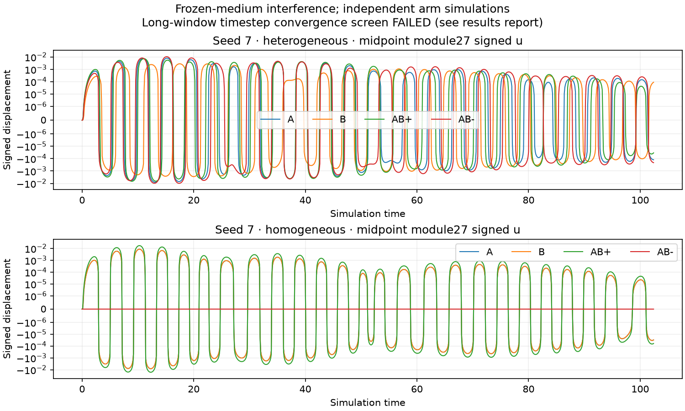
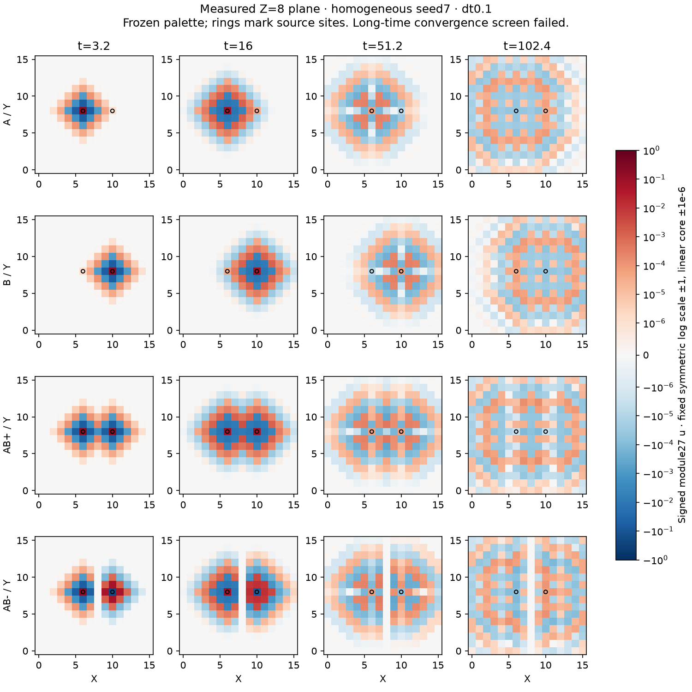
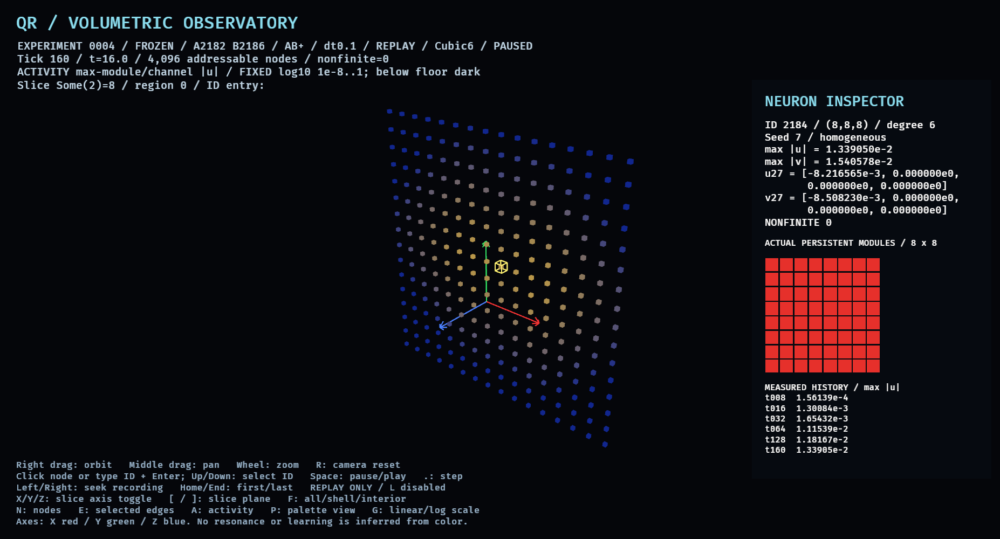

# Experiment 0004 — extended propagation, dual waves and superposition

Measured 2026-11-13. [Registration](../EXPERIMENT_0004.md) frozen in
`4a2283a` before implementation and collection. Implementation checkpoint `f4e97f5`. Experiments 0001–0003 remain
unchanged; the shared viewer has an explicitly labeled replay-only 0004 path.

**Observed:** disturbances from both sources overlap, and independently simulated
dual-source fields obey signed superposition within floating-point roundoff.
Longer observation increases cumulative threshold reach. **Failed numerical
screen:** all eight matched-time half-step comparisons exceed the registered
10% limit. No persistent palette changes, learning or memory trace were observed.

## Execution and evidence

Each of two complete suites contains **35 executions**:

- Six primary groups: seeds 7/19/41 × heterogeneous/homogeneous, Cubic6,
  dt=0.1, 1,024 steps, duration102.4. Four independently integrated arms each:
  A, B, AB+ and AB− (24 executions).
- Seed7/both configurations at dt=0.05, 2,048 steps, same duration; eight arms.
- Two full-duration zero controls and one 160-step whole-observation regression
  against the unchanged Experiment 0003 center-impulse engine.

Sources are module27/channel1 at A=(6,8,8), ID2182, and B=(10,8,8), ID2186.
The midpoint is ID2184 at (8,8,8). Initial source displacement is +1, or −1 for
B in AB−; velocity and subsequent forcing are zero. Duals have initial sum(u²)=2,
singles1. They are not equal-total-energy comparisons. Squared fields are
mathematical diagnostics, not physical conserved energy.

All 4,096 neurons retain their own independent 8×8 palette. Only the driven
independent channel is stored in the new scalar engine; the other three have
exactly zero initial state/forcing and no cross-channel coupling. The inherited
configuration-dependent oscillator, damping and synchronous semi-implicit Euler
rule are unchanged. External coupling remains 0.4/6 with open boundaries;
internal coupling is 0.6/4. No clipping, plasticity or renderer enters the update.

`results/experiment_0004-final-a` and `results/experiment_0004-final-b` compare byte-for-byte
identical, including independent analysis. This is a same-machine/toolchain
observation, not a cross-platform guarantee. Each suite exports **408 full signed
frames**, 12 physical-time checkpoints per non-regression arm/control, plus
all-tick global/residual/midpoint measurements and cumulative spatial maps.
Every frame was decoded and checksum-checked by both Rust and independent
standard-library Python; Python additionally verified a SHA-256 ledger:

`f0b05245646526228f6a1ad9f8972d883a9e260e20b7cbe565efdf03cc5ac172`

The ledger identifies all 408 frame files. Full-field independent recomputation
is at recorded checkpoints; the full-field every-step residuals and boundedness
screens are Rust measurements, with independent consistency checks of their
exported metrics. This distinction matters because not every integration state
was recorded. Checkpoints have unequal physical intervals; movies must label
that explicitly. All raw evidence remains ignored under `results/`.

Both zero controls stayed exactly zero; all 161 regression observations matched
the old engine exactly. No numerical boundedness screen failed, no nonfinite
values occurred, and all exported palettes remained byte-identical. These
finite-run facts do not establish long-time integration accuracy or general
stability. Two earlier complete suites (`results/experiment_0004-a` and `-b`) remain
retained. Final review found that they omitted the registered time16 cumulative
per-neuron peak export. The final two fresh suites add that measurement column
(`peak_at_time16`) without changing dynamics, sources, seeds, horizon or criteria.
The full signed frame ledgers remain identical to those of the earlier runs;
plots/native capture from those bytes therefore remain valid. This was an
instrumentation correction, not a retuned experimental arm.

## Superposition and interference

For each module and each tick, independently integrate all four arms and compare:

    u_AB+ ≈ u_A + u_B       v_AB+ ≈ v_A + v_B
    u_AB− ≈ u_A − u_B       v_AB− ≈ v_A − v_B

Maximum absolute u/v residual over all eight groups:
**1.4432899320127035e-15**, below the fixed 1e-10 × max(1, max|A|+|B|)
tolerance. Full-field relative L2 residuals and signed cross terms are retained.
Independent Python reproduces checkpoint residuals and verifies
sum((A±B)²)−sum(A²)−sum(B²) ≈ ±2·dot(A,B), for both u and v.
Magnitude overlays, peak fields and per-neuron squared diagnostics were not
added as substitutes for signed fields.

First simultaneous midpoint-neuron threshold crossing (both A/B max-module
|u|≥1e-6): heterogeneous seeds7/19/41 at times0.5/0.4/0.5; homogeneous at0.3
for all seeds. Half-step seed7 crossings are0.45 (heterogeneous) and0.3
(homogeneous). These are discrete threshold detections, not physical wave speeds.

Signed midpoint module27 displacement at time3.2, dt0.1, seed7:

| Configuration | A | B | AB+ | AB− |
|---|---:|---:|---:|---:|
| Heterogeneous | −1.57291828e-4 | +1.56937472e-4 | −3.54355430e-7 | −3.14229300e-4 |
| Homogeneous | −8.27158101e-4 | −8.27158101e-4 | −1.65431620e-3 | +2.18e-19 |

The heterogeneous paths yield nearly opposite signs here: same-polarity source
impulses nearly cancel at this point/time. Opposite source polarity reinforces.
Homogeneous paths instead show the expected early midpoint cancellation for
AB− and reinforcement for AB+. The source placement is not globally symmetric
about the finite lattice boundaries (x=0..15), so exact midpoint cancellation at
all later times is not assumed. At time102.4 homogeneous AB− midpoint u is
about −1.28e-9; this is not an experience-induced persistent change.

The plane figure shows **signed module27 u**, not max-module amplitude. All
panels use the same symmetric logarithmic scale, bounds ±1, linear core ±1e-6.
No per-frame gain or independent panel normalization is applied. Source rings
mark locations, not modified neurons. The displayed long-time structures remain
subject to the failed timestep screen below.

## Extended cumulative reach

Counts are neurons that crossed max-module |u|≥1e-6 at least once by the stated
time, not neurons simultaneously active, readable associations or signal capacity.
Each entry is time16 → time102.4, dt0.1:

| Configuration / seed | A | B | AB+ | AB− |
|---|---|---|---|---|
| Heterogeneous7 | 314→985 | 294→919 | 514→1422 | 511→1420 |
| Heterogeneous19 | 274→887 | 309→958 | 493→1371 | 489→1375 |
| Heterogeneous41 | 292→915 | 264→667 | 476→1210 | 473→1214 |
| Homogeneous7/19/41 | 467→3726 | 467→3480 | 755→4011 | 694→3776 |

Homogeneous seeds produce identical initialized palettes and identical results;
they are not three distinct homogeneous media. The half-step cumulative counts
are close but not identical (e.g. homogeneous AB+4007 rather than4011 at the
final time). Threshold-count agreement alone does not establish field convergence.

## Failed long-window convergence screen

At each matched physical checkpoint, compare the full signed u/v vector against
dt0.05 using combined relative L2 error. Every arm's worst checkpoint is the
final time102.4. Registration requires **all** checkpoints ≤10%:

| Configuration / seed7 | A | B | AB+ | AB− |
|---|---:|---:|---:|---:|
| Heterogeneous maximum | 30.424% | 27.763% | 29.641% | 29.642% |
| Homogeneous maximum | 29.074% | 29.073% | 29.085% | 29.062% |

**0/8 pass.** Finite, bounded output and roundoff-level superposition do not
remove this failure. Each discrete linear integrator can obey superposition
while its long-time trajectory changes materially with timestep. This experiment
therefore supports a discrete-model superposition result, while the registered
accuracy screen rejects treating the long-window fields as converged dynamics.
No resonance, coherence or physical-fluid inference follows from the images.
A finer timestep/window study requires a new registration; no thresholds or
parameters were adjusted after observing these results.

## Instrument and software evidence

New Rust modules: `propagation_0004` (fixed medium, signed format, replay loader)
and `experiment_0004` (separate runner). `QR4FLD01` schema1 records exact step,
dt, configuration/seed, arm, both source IDs, actual palette, full active-channel
u/v and FNV checksum. Open Cubic6 geometry/channel1 are fixed schema/model rules.
The new format does not reuse 0003's single-source provenance or aggregate-only
file encoding. New observations are decoded into the existing display structure
only after full-format validation.

The shared Bevy viewer accepts `--experiment-0004`, labels the arm, both sources,
frozen medium, timestep, tick and measured time, and prohibits LIVE/synthetic/
0003-witness modes for these recordings. L cannot instantiate the old engine.
Normal 0003 replay/live behavior remains available. Startup selection/slicing,
frame index, play and replay cadence options make scripted views reproducible
without relying on desktop keyboard focus. They change presentation only.

Native Raphael replay evidence is under `results/0004-native`; source/renderer
receipts identify the AMD integrated GPU, Vulkan/radv, Mesa26.2.6-arch1.1, X11
on Wayland/XWayland. A native movie shows the selected midpoint and Z=8 slice
through the 12 recorded checkpoints. The separate signed-plane movie is an
offline plot animation from actual observations; it is not a native screen
recording. Fixed plot and viewer magnitude scales are explicitly different.

Automated desktop key injection proved unreliable, so native replay was driven
by explicit startup selection/slice/play controls; no failed key sequence is
claimed as successful validation. No FPS benchmark or exhaustive human testing.

Local quality gates: 23 root Rust tests, 12 Python tests, one isolated viewer
test, formatting, strict Clippy/Ruff, root release build, doctests/rustdoc with
warnings denied, Python compilation and native viewer build. New tests cover
signed superposition/cancellation, regression/order invariance, full-field format
roundtrip/corruption, independent format/coverage failures, and replay-only
LIVE prevention. Protected old experiment files retain their original SHA-256
values; `src/lib.rs` only adds new module exports. Shared viewer changes are
separate from frozen scientific sources. See `HANDOFF.md` for delivery state and
commit-specific hosted CI.

Next scientific step: separately register an integration/window refinement study
before interpreting detailed long-time fields or introducing plasticity. The
later question—whether two disturbances can leave a persistent, distributed
change—remains open and unimplemented. Current frozen-medium interference is
not a memory mechanism.
