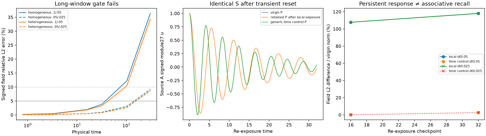
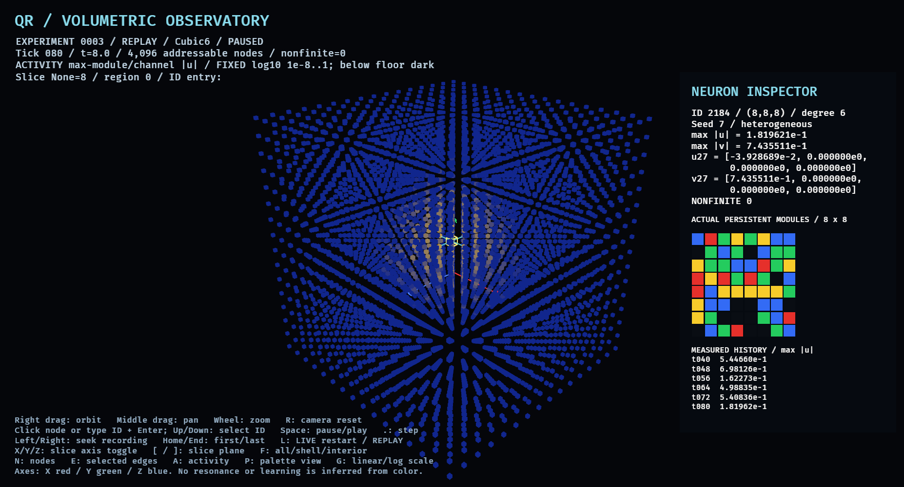
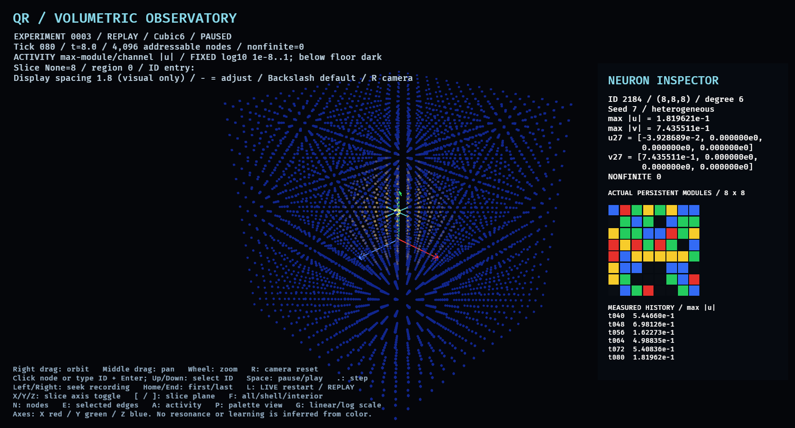
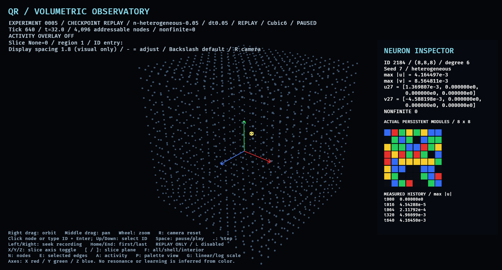

# Experiment 0005: measured morphic response and adaptive excitation

Measured 2026-11-13. [Frozen registration](../EXPERIMENT_0005.md), commit
`5b97a755aceb82da604631c351299c9929ae2b8d`, SHA-256
`44a8e97fddb49f9969e6db5063bef39e6aba4f679f987568935c29903988a33e`.
Implementation checkpoint `a7da357`; subsequent independent coverage, packaging
and supplemental transition-audit instrumentation are documented below.
No registration thresholds, equations or conditions were retuned after results.

**Short-window energy, signed superposition and persistent causal response
checks pass. The registered long-window numerical gate fails.** M5-B's additional
long/boundary conditions were therefore not executed. This is a bounded study
of a constructed oscillator and local reconfiguration rule, not evidence of
associative memory, R1 resilience, cognition, consciousness or new physics.
Principle 002 remains proposed; Principle 001's retrieval claim is untested here.

## Execution and evidence

The ignored root `results/experiment_0005` contains **51 primary executions**:
12 M5-0 numerical/control cases, 25 M5-A morphology cases, 14 short M5-C exposure/
re-exposure/control cases. They contain **72, 979 tick observations and 258 full
signed checkpoints**. Every tick's global metrics and 11 registered probes are
retained. All-node spatial summaries and actual 4096×8×8 palettes are exported.
Full fields are recorded only at registered checkpoints; no interpolated ticks.

One fresh M5-A heterogeneous 7 AB+ repeat matches every original case file
byte-for-byte:52 primary/repeat executions total. Four supplemental deterministic
transition replays additionally export 8 pre/post full fields at time 8. Their
local histories and time 16 full checkpoints match primary bytes exactly.
These are audit repetitions, not independent seeds or new confirmatory conditions.
No exploratory calibration runs were used. Only two heterogeneous seeds 7/19
were registered; homogeneous 7 is one medium, not multiple independent samples.

`execution-ledger.csv` enumerates all 57 registered condition IDs, including 6 gated
M5-B entries. Two open AB+ references already exist as M5-0 runs; four additional
long/sponge executions are absent. No absorption result or completed boundary
comparison is claimed. Short M5-C uses the **applicable time 32** accuracy gate;
it does not inherit a claim that the long-window gate passed.

The analyzer independently decodes/checksums every retained full frame,
reconstructs mechanical energy using tensor-neighbor slices independent of the
engine edge list, and checks signed fields, actual palettes and control pairings.
Every-tick exported energy arithmetic/finite bounds/probe coverage and probe
event decisions are checked separately. It does not independently reintegrate
physics or recompute all-module fields at unrecorded ticks. All-node cumulative
maps are Rust measurements; selected probe events are independently recomputed
at every tick. FNV/SHA checks are integrity checks, not authentication.

## M5-0: energy audit passes; long-window accuracy fails

New serial CPU f64 engine, 4096 independent palettes, open 16³ Cubic6, active channel 1,
internal 8×8 cardinal graph. Coefficients are inherited without changing old
engines. New second-order integrator: exact half damping, velocity-Verlet for
stiffness/constant force, exact half damping. Each neighbor-dependent force uses
one unchanged displacement vector. No clipping, pruning, normalization or GPU
updates. The symmetric graph has 1, 196, 032 undirected module edges.

Energy is kinetic + onsite potential + once-per-edge coupling potential.
Exact damping-substep loss, constant-force work and morphology-switch work are
reported separately from numerical drift. Local energy assigns half of each
edge potential to each endpoint. External-edge instantaneous powers cancel
pairwise; they are continuous energy-balance diagnostics, not exact integrated
step work. All hard boundedness/nonfinite screens pass; all 7 zero-input controls
remain exactly zero. No autonomous energy source appears in a zero state.

Primary dt .05 worst cumulative absolute drift / registered energy scale:

| Control | Drift fraction (%) | Registered limit |
|---|---:|---:|
| Homogeneous AB+, through 307.2 | 0.14971 | 1% |
| Heterogeneous 7 AB+, through 307.2 | 0.13094 | 1% |
| Undamped homogeneous AB+, through 32 | 0.14797 | 1% |
| Constant force 0.1 from zero, through 16 | 0.03894 | 1% |

Undamped drift decreases with refinement:0.59186%, 0.14797%, 0.03699% for
.1,.05,.025. Energy audit success does not establish phase/trajectory accuracy.
Matched full signed u/v relative L2 errors (denominator:finer field norm):

| Morphology | Time | .1 versus .05 | .05 versus .025 | Gate |
|---|---:|---:|---:|---|
| Homogeneous | 32 | 3.8136% | 0.9516% | Pass |
| Heterogeneous 7 | 32 | 3.2482% | 0.8091% | Pass |
| Homogeneous | 102.4 | 12.1832% | 3.0416% | **Fail** |
| Heterogeneous 7 | 102.4 | 10.4102% | 2.6012% | **Fail** |
| Homogeneous | 307.2 | 36.3787% | 9.1311% | **Fail** |
| Heterogeneous 7 | 307.2 | 34.4009% | 8.6430% | **Fail** |

Both successive-grid errors must satisfy 5% through 102.4 and 10% at 307.2.
The fine/coarse error ratios~0.25 are compatible with second-order convergence,
but do not override failure of the absolute thresholds. Every applicable short
control passes through 32. Long-time interpretation remains **indeterminate**;
M5-B is gated. No added dt or relaxed threshold was substituted post hoc.
Historical 0004's 0/8 passes and the extension's missing 307.2 refinement remain
unchanged; this new integrator does not retroactively validate their trajectories.



## M5-A: spatial palettes, linearity and delayed local events

Five media (homogeneous 7, heterogeneous 7/19, rearranged 7/19), five arms each
(A, B, AB+, AB-, zero), dt .05, time 32. Rearrangement preserves each neuron's full
palette histogram and module 27 color; the 8×8 arrangement changes coefficients.
All frozen palettes remain byte-identical. Fifty checkpoint/sign superposition
comparisons pass; maximum absolute signed u/v residual **1.5543122344752192e-15**,
below 1e-10×max(1, max|A|+|B|). Magnitude envelopes were not summed as fields.

AB+ cumulative neuron reach at max-module|u|>=1e-6 through 32:

| Medium | Initial energy | Final energy | Threshold-crossing neurons |
|---|---:|---:|---:|
| Homogeneous 7 | 2.3456000 | 0.1813179 | 1532 |
| Heterogeneous 7 | 2.0545000 | 0.0772770 | 820 |
| Rearranged 7 | 2.1579500 | 0.1051576 | 1262 |
| Heterogeneous 19 | 1.8987625 | 0.0707869 | 819 |
| Rearranged 19 | 2.0759375 | 0.1052089 | 1223 |

These are equal **initial displacement** comparisons, not equal mechanical-energy
budgets; different P changes stored energy. They are not a capacity or transport
superiority ranking. Rearranged-versus-original signed field L2 differences at 32
are 148.87% and 158.28% for 7/19, using each original field norm. Such ratios can
exceed 100%; they do not represent an accuracy score.

Delayed local maxima and subsequent upward threshold crossings occur. For
heterogeneous 7 AB+, source A has 16 separated envelope peaks, midpoint 18, and source
B20 during 32 time units; their max-module envelopes each cross threshold once.
Boundary-face probe 2191=(15, 8, 8) has 2 crossings (one subsequent) and 9 separated
peaks. Homogeneous 2191 has 3 crossings and 15 peaks. Corner 0 never crosses in
these short examples. Peak separation>=1, threshold 1e-6, strict local maxima,
and below-threshold reset rules were frozen before data.

A recrossing is not by itself evidence of neighbor-return excitation:local
ringing, interference and reflections remain competing explanations. Existing
open boundaries do not absorb. Because the registered long-window numerical
gate prevented the sponge comparison, reflection/reciprocal-return attribution
remains unresolved. Probe spectra/phase at angular.8, 1.2, 1.6 are exported
finite-window transient DFTs, not steady-state gains or resolved resonance peaks.

## M5-C: bounded experience-dependent changes survive transient reset

Seed 7 heterogeneous, dt .05/.025. Each module integrates its own v² over[0, 8].
At 8 each neuron chooses its largest local-history module; integral>=1e-8 permits
one cyclic palette edit (P+1)%5. No target, global reward or neuron-ID exception.
The rule is local to a neuron's own history; it is not specifically a detector
of energy received from neighbors. A single synchronized edit opportunity,
maximum 1 edit/neuron; no further adaptive commits during re-exposure.

Both grids produce **exactly the same 63 edited palettes**, 63/4096 neurons (1.54%).
All edits select module 27 in this fixture; there is no demonstrated learning of
a more elaborate internal spatial shape. Graph-distance counts from A are
0:1, 1:6, 2:18, 3:37, 4:1. Edits do not saturate the 4096-neuron population; the
one-edit bound is enforced. Full actual 8×8 before/after arrays and differences
for all 4096 neurons are in `derived/c-local-DT/palettes.jsonl`; raw palettes and
local integrals are independently checked against the registered rule.

Primary time 8 switch energy:0.5017458461894584→0.3655830695794730,
**work=-0.1361627766099854**. Fine-grid work=-0.1358984203658424. Independent
pre/post full-field energy reconstruction confirms both jumps and unchanged
u/v at the switch. The model is **externally actuated, not energy-neutral**;
a negative jump removes stored energy. It is explicitly in the balance.

After exposure S=A, reset every u/v/history to zero, retain actual Pafter, and
apply identical unit-displacement S with plasticity disabled. Compare to virgin
Pbefore and the disabled-history-path control. Virgin/disabled responses match
exactly. Zero-input active-rule controls produce 0 edits. Generic-time controls
edit module 0 in all 4096 neurons at 8; they are intentionally not edit-count or
histogram matched to the local rule.

| Re-exposure | dt | Changed-neuron count during exposure | Relative field difference at 16 | At 32 |
|---|---:|---:|---:|---:|
| Retained local-rule P | .05 | 63 | 107.7267% | 118.0315% |
| Retained local-rule P | .025 | 63 | 107.6463% | 117.9053% |
| Retained generic-time P | .05 | 4096 | 0.0718% | 2.5989% |
| Retained generic-time P | .025 | 4096 | 0.0716% | 2.5947% |

The registered>=1%effect, both-grid 20%agreement and<=5%change-count-difference
criteria pass. This demonstrates **persistent causal response change under the
specified rule**. It is not an association or retrieval result. Source A itself
changes module 27 from 4 to 0. Consequently identical initial displacement stores
1.1332625 energy in virgin P versus 0.6493417 in retained P. The initial mechanical
energy differs by construction; no energy-matched response superiority claim.
A source-only change could account for much of the measured effect; no ablation
establishes that distributed off-source changes are necessary. The generic-time
control has a different edit budget and is not a causal isolation of that issue.

## Viewer spacing and native evidence

Default viewer-only node-center spacing **1.8**, CLI finite 1..3, Minus/Equal live
adjustment, Backslash 1.8 reset, Rcamera fit. Physical integer coords, stable IDs,
graphs, couplings, time, palettes and exports remain unchanged. Spacing is used for
spawned/updated transforms, picking, selected edges, axes and camera fitting/pan/
zoom/reset/witness poses. Slices remain in integer coordinates. Tests cover
Cubic6,Cubic26 and Grid2D8, snapshot byte identity at 1/1.8/3, picking and edge ends.

Actual before/after 0003 native witnesses have byte-identical 67-row scientific
and UI-binding audits. Both run at configured 30 FPS caps; no sustained-FPS claim.
Adapter:AMD Ryzen 9 7950 X (RADV RAPHAEL_MENDOCINO), IntegratedGpu, Vulkan/radv,
Mesa 26.2.6-arch 1.1, X11 on Wayland/XWayland. Native 0005 checkpoint replay and old
0004 tick 256/decaytick 1600 captures report 0 engines and spacing 1.8.0005 rejects
LIVE/synthetic/old-witness substitution. No old scientific schema was broadened.







An initial 0005 capture-receipt attempt failed because it called the old 0003
encoder restricted to 160 ticks. The receipt now uses a dedicated checksum over
observation fields, excluding display settings. The failed log and successful
retry are retained. It did not alter scientific data. Native captures and
witnesses are instrument evidence, not exhaustive human usability/keyboard tests
or measured monitor scanout. No synthetic desktop key events were used.

## Reproduction, portable package and limits

Install `requirements-dev.txt` and `requirements-analysis.txt`; optional figures
use `requirements-plot.txt`. Run the README's separate numerical, A and C commands.
B deliberately returns the failed-gate error. Repeat uses a separate output root.
Then export/check exact switch fields and independently verify:

```sh
cargo run --locked --release --bin experiment_0005_transition_audit -- results/my-0005
.venv/bin/python -m analysis.experiment_0005 results/my-0005
.venv/bin/python -m analysis.plot_experiment_0005 results/my-0005 docs/figures/experiment_0005_measured.png
.venv/bin/python -m analysis.package_experiment_0005 results/my-0005 --native results/0005-spacing --repeat results/my-0005-repeat
```

Local `AGENT_REPORT.zip` includes this report, CSV traces, actual palettes, local
histories, all-neuron palette diffs, schema, sources, rules, execution ledger, independent
verification, native receipts/screens and SHA manifests. `FULL_FIELDS.zip`
separately contains all 266 primary/supplemental full signed checkpoints. Extract
both into one directory for full independent field reanalysis. Portable CSVs
can be analyzed without the viewer or full-field archive. Neither data archive
is committed to Git. Source/provenance copies distinguish original numerical
instrumentation from later history-export, coverage and transition-audit additions;
these did not change dynamics or criteria.

All 44 protected 0001–0004 files match their baseline SHA-256 receipt. Old raw evidence
was not changed. Local final checks:27 root Rust tests, 18 Python tests, 2 viewer
tests, formatting, strict Clippy/Ruff, root release/docs/doctests, Python compilation
and isolated native viewer build. Package integrity and final hosted delivery
are recorded in HANDOFF separately; software green does not change failed science.

Remaining unexecuted:the 4 new long M5-B/sponge runs and their comparison to 2 existing
open references. No measured absorption/reflection attribution is available.
Next bounded work requires a **new registration** for finer long-window grids,
then boundary controls. A separate source-held-fixed/off-source-edit ablation
would test whether the 63 distributed changes are causally necessary. No current
result establishes learned associations, useful recall, capacity or R1 resilience.
