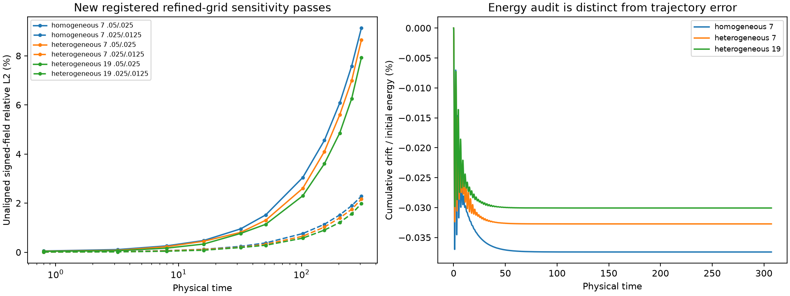
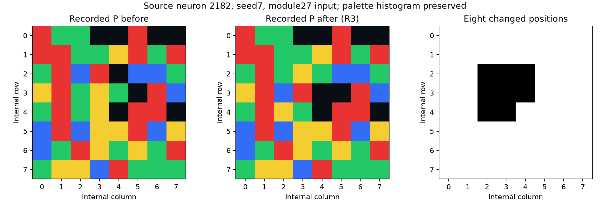
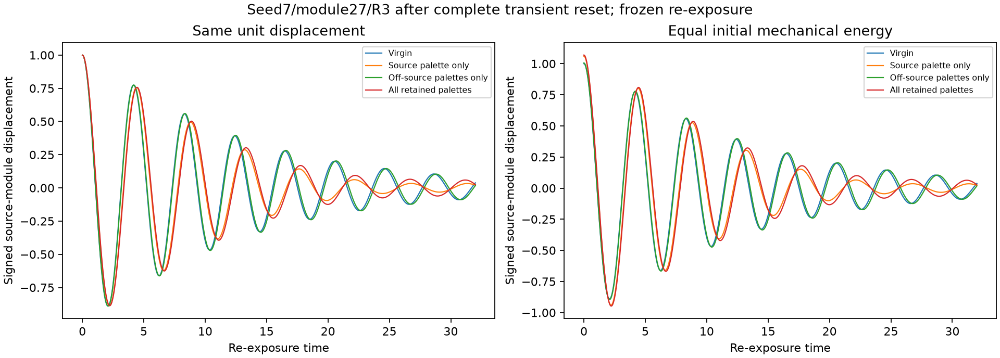
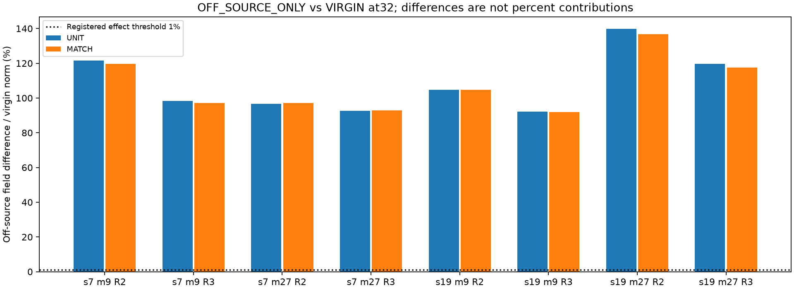
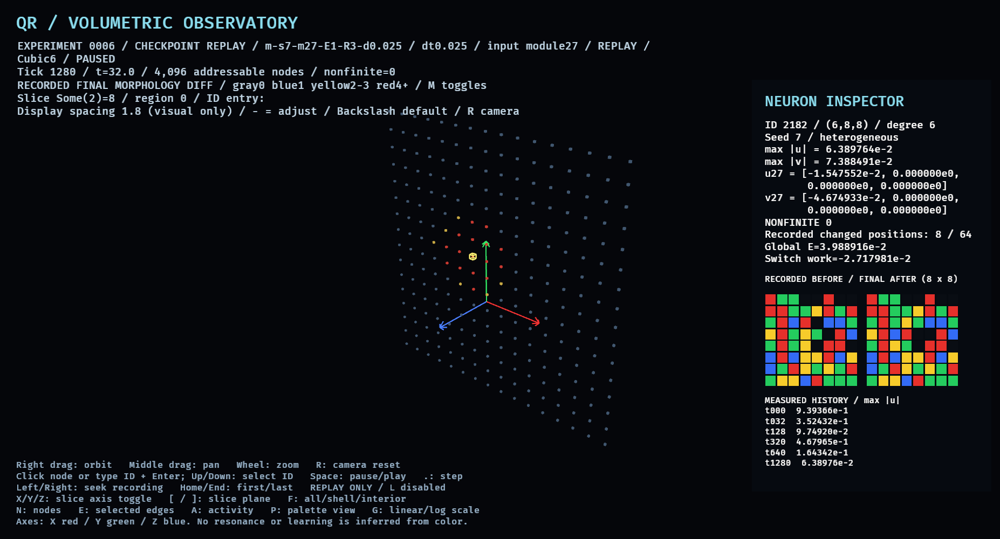

# Experiment 0006: multi-module morphology and causal re-exposure

Measured 2026-11-13. Registration `578870c` froze the equations, thresholds and
matrix before confirmatory data. Implementation `6904303`; instrument/verification
checkpoint `673eddf`. [Design](../EXPERIMENT_0006.md),
[inventory](EXPERIMENT_0006_INVENTORY.md), [schema](EXPERIMENT_0006_SCHEMA.md).
The user brief was a proposed design, not prior evidence. No pilots or post-result
retuning were used. M5's failed accuracy criteria and all historical files remain
unchanged. Principle 002 is proposed; this is not an associative memory experiment.

## Results and coverage

M6-N refined numerical screen: **PASS**.
M6-M selected structural/fine-grid checks: **4/4 pass**.
M6-C selected off-source causal gates: **8/8 pass**.
These are finite deterministic model results, not physical fidelity, learning,
consciousness, general stability or R1 resilience claims.

All **190 logical conditions** are accounted for: N 12, D 10, M 48, C 120. There are
**168 primary executions and 22 explicit reuses**; the preselected raw-case repeat
adds one execution. No planned condition is unexecuted. Primary output includes
375,592 every-tick global observations, 1,052 main full signed checkpoints,
and 116 separate pre/post switch fields. All source/probe observations
are actual engine outputs, not interpolation. C VIRGIN reuse names its original
trajectory without rewriting frame labels or pretending it is a new sample.

All fields remain finite/bounded, all 13 registered zero-input controls stay zero,
and no clipping, hidden drive or outcome normalization occurs. Worst measured
absolute cumulative energy drift/E0 across primary runs: **0.14971%**;
registered bound 1%. Exact damping loss and palette-switch work are separate.
Static causal-variant construction precedes t0; re-exposure bookkeeping starts
after complete transient/history/audit reset with explicitly measured E0.

## M6-N: refinement resolves the registered sensitivity screen

Same serial CPU f64 physical coefficients, edge order and second-order
Strang-damping/velocity-Verlet method as M5. Only the registered step grid changes.
Limits are **informed by M5 observations**: through 102.4, .05/.025<=5% and
.025/.0125<=1.5%; later checkpoints through 307.2 require<=10% and<=3%, ratio<=.35.
Both comparisons must pass every retained checkpoint. The new pass is not a
retrospective pass of M5's .1/.05 criterion, nor a proof of physical fidelity.

| Fixture | Physical time | .05/.025 signed L2 | .025/.0125 signed L2 | Error ratio |
|---|---:|---:|---:|---:|
| homogeneous 7 | 32 | 0.9516% | 0.2378% | 0.2499 |
| homogeneous 7 | 102.4 | 3.0416% | 0.7600% | 0.2499 |
| homogeneous 7 | 307.2 | 9.1311% | 2.2823% | 0.2500 |
| heterogeneous 7 | 32 | 0.8091% | 0.2021% | 0.2498 |
| heterogeneous 7 | 102.4 | 2.6012% | 0.6502% | 0.2500 |
| heterogeneous 7 | 307.2 | 8.6430% | 2.1616% | 0.2501 |
| heterogeneous 19 | 32 | 0.7652% | 0.1912% | 0.2499 |
| heterogeneous 19 | 102.4 | 2.2968% | 0.5738% | 0.2498 |
| heterogeneous 19 | 307.2 | 7.9264% | 1.9793% | 0.2497 |

33/33 nonzero fixture/checkpoint decisions pass.
The numerical plot joins registered checkpoints only, not interpolated fields.
Absolute RMS, source/midpoint/
boundary waveform disagreements and nearest separated-peak timing diagnostics
are exported. Peak alignment does not replace unaligned acceptance. As signals
decay, absolute RMS and relative errors must be read together. An independent
analytic uniform-mode unit fixture checks second-order refinement; it is a test
fixture, not a new scientific model. Four old/new seed7 field arrays through 307.2
match M5 byte-for-byte; historical source files and verdicts were not changed.

## M6-D: module 27 follows the drive coordinate

Frozen P, source A, seeds 7/19, modules27/9, unit-displacement and mechanical E1
conditions. Input amplitudes come from the actual full quadratic energy, not
sum(u²)+sum(v²). Every E1 trial independently matches energy1 within1e-12.
Raw V argmax uses the original 1e-8 threshold; counts below refer only to qualified
neurons, not the4096-neuron population or a mandatory edit count.

| Frozen diagnosis case | Argmax module: qualified-neuron count |
|---|---|
| d-s19-m27-E1 | 27:60, 28:1 |
| d-s19-m27-UNIT | 27:60, 28:1 |
| d-s19-m9-E1 | 1:2, 9:60 |
| d-s19-m9-UNIT | 1:2, 9:60 |
| d-s7-m27-E1 | 27:63 |
| d-s7-m27-UNIT | 27:63 |
| d-s7-m9-E1 | 9:61 |
| d-s7-m9-UNIT | 9:61 |

Module27 is not special in the argmax law. Changing the injection coordinate
changes the dominant selected index. The single-edit cap guarantees at most one
position even when other positions carry history. Matching-index external links
and the point input favor that index. This study does not independently ablate
each graph/measure/cap contribution, so their separate causal weights remain
unresolved. Full per-module V/H/S/ranks, per-neuron spread/distances and graph-hop
summaries are exported; weak nonzero signals are not automatically eligibility.
Historical R1 unit seed7/module 27/.025 reproduces M5's63 edits and full time 16
u/v/P/history bytes exactly. It is a regression, not new multi-module success.

## M6-M: multi-position recoloring and actual shape-only swaps

R2 uses locally measured v² plus internal strain history, then one-hop own-neuron
eligibility; at most8 qualified positions recolor. R3 greedily selects up to 4
disjoint cardinal unequal-color swaps using old P and local scores. R3 preserves
every neuron's palette histogram. No minimum edit quota, target layout, reward
or neuron-ID frequency is used. The .25 strain coefficient and .5 smoothing
coefficient are chosen model parameters, not biophysics. One commit at 8 remains
a deliberate bound; continuing autonomous morphogenesis was not tested.

| Primary E1 case | Neurons | Positions | Switch work | Position histogram 0..8 |
|---|---:|---:|---:|---|
| m-s19-m27-E1-R2-d0.025 | 61 | 330 | -0.00146897 | [4035, 5, 3, 2, 2, 24, 7, 1, 17] |
| m-s19-m27-E1-R3-d0.025 | 55 | 286 | -0.00751073 | [4041, 0, 23, 0, 2, 0, 4, 0, 26] |
| m-s19-m9-E1-R2-d0.025 | 62 | 356 | -0.11688780 | [4034, 1, 1, 2, 0, 20, 19, 19, 0] |
| m-s19-m9-E1-R3-d0.025 | 60 | 372 | 0.00076238 | [4036, 0, 12, 0, 3, 0, 12, 0, 33] |
| m-s7-m27-E1-R2-d0.025 | 63 | 302 | -0.13913867 | [4033, 4, 1, 0, 1, 53, 1, 3, 0] |
| m-s7-m27-E1-R3-d0.025 | 59 | 370 | -0.02717981 | [4037, 0, 15, 0, 0, 0, 6, 0, 38] |
| m-s7-m9-E1-R2-d0.025 | 62 | 392 | -0.03090979 | [4034, 3, 2, 1, 0, 10, 9, 18, 19] |
| m-s7-m9-E1-R3-d0.025 | 59 | 386 | -0.02659178 | [4037, 0, 8, 0, 7, 0, 5, 0, 39] |

Reported changes involve multiple actual coordinates in one neuron's 8x8 array.
They remain concentrated near the injection coordinate; the rule does not
establish rich organization or useful learned structure. All before/after arrays
and per-module differences are retained for 4096 neurons in every exposure.
Saturation, source/immediate-neighbor/remote counts and actual color changes are
in morphology-summary.csv. Frozen and disabled controls have identical signed
states and palettes; zero-input adaptive controls make no edits.

| Fine pair | Position Jaccard | Error at16 | Error at32 | Structural decision |
|---|---:|---:|---:|---|
| 7/27/R2 | 1.0000 | 0.0900% | 0.1395% | PASS |
| 7/27/R3 | 1.0000 | 0.1048% | 0.2025% | PASS |
| 19/9/R2 | 1.0000 | 0.0880% | 0.1418% | PASS |
| 19/9/R3 | 1.0000 | 0.1192% | 0.2336% | PASS |

All four selected pairs also produce byte-identical Pafter. Persisting palette
positions are checked after transient reset in frozen ALL re-exposure. This is
structural persistence with a changed mechanical response, not an association.

Palette changes can add or remove stored energy even for histogram-preserving
swaps. Pre/post signed fields hold u/v exactly fixed; independent graph-energy
reconstruction checks every neuron's half-edge energy partition and total work.
The adaptive model is externally actuated, not energy-neutral. No apparent
resurgence is treated as self-powered activity.

## M6-C: source/off-source causality after complete reset

Pbefore/Pafter are immutable. VIRGIN, SOURCE_ONLY, OFF_SOURCE_ONLY, ALL and
SHUFFLE_POSITION each undergo frozen time 32 re-exposure after all u/v/history/
audit accumulators reset. UNIT means identical displacement1 with actual E0
reported; MATCH means identical mechanical E0 to virgin unit input, with the
explicit amplitude sqrt(E0_virgin/E0_variant_unit). No outcome is normalized.

The shuffled control preserves changed-neuron IDs, exact per-neuron edit count
and graph-distance distribution. R3 also preserves each palette histogram;
its control swaps need not be cardinal and are labeled accordingly. R2 shuffled
color-change histograms may differ and are not claimed matched. A control with
all 4096 neurons changed was not substituted for the local edit budgets.

Differences above100% are possible because the norm is relative to the virgin
field; they are not accuracy, improvement or percent-contribution scores.
Absolute RMS is also reported. OFF_SOURCE_ONLY versus VIRGIN excludes source A
from the observation mask:

| Seed/module/rule | Input comparison | Relative L2 at16 | At32 | Absolute RMS at32 |
|---|---|---:|---:|---:|
| 7/27/R2 | UNIT | 97.656% | 96.724% | 2.684969e-04 |
| 7/27/R2 | MATCH | 97.904% | 97.030% | 2.693460e-04 |
| 7/27/R3 | UNIT | 80.537% | 92.629% | 2.571316e-04 |
| 7/27/R3 | MATCH | 80.682% | 92.846% | 2.577340e-04 |
| 7/9/R2 | UNIT | 132.289% | 121.628% | 3.753859e-04 |
| 7/9/R2 | MATCH | 129.758% | 119.762% | 3.696279e-04 |
| 7/9/R3 | UNIT | 107.199% | 98.384% | 3.036457e-04 |
| 7/9/R3 | MATCH | 105.597% | 97.107% | 2.997047e-04 |
| 19/27/R2 | UNIT | 168.503% | 139.721% | 2.882807e-04 |
| 19/27/R2 | MATCH | 164.193% | 136.730% | 2.821084e-04 |
| 19/27/R3 | UNIT | 152.927% | 119.655% | 2.468787e-04 |
| 19/27/R3 | MATCH | 149.678% | 117.584% | 2.426052e-04 |
| 19/9/R2 | UNIT | 101.642% | 104.730% | 2.616224e-04 |
| 19/9/R2 | MATCH | 101.524% | 104.630% | 2.613710e-04 |
| 19/9/R3 | UNIT | 89.899% | 92.173% | 2.302544e-04 |
| 19/9/R3 | MATCH | 89.591% | 91.895% | 2.295592e-04 |

The selected fine-grid causal gate requires>=1% effects at both16/32, both grids,
<=20% effect disagreement and<=1.5% unaligned coarse/fine fields per variant.
"Source-only nearly matches ALL" requires<=1% ALL/SOURCE_ONLY difference at both
checkpoints on the off-source mask. These are defined group contrasts, never
an additive decomposition or percent contribution.

| Selected fine pair | Input comparison | Causal gate | Source-only nearly matches ALL |
|---|---|---|---|
| 7/27/R2 | UNIT | PASS | False |
| 7/27/R2 | MATCH | PASS | False |
| 7/27/R3 | UNIT | PASS | False |
| 7/27/R3 | MATCH | PASS | False |
| 19/9/R2 | UNIT | PASS | False |
| 19/9/R2 | MATCH | PASS | False |
| 19/9/R3 | UNIT | PASS | False |
| 19/9/R3 | MATCH | PASS | False |

Source-only nearly matches ALL in **0/8** selected comparisons at the
registered1% criterion. The source-only description is insufficient for these
R2/R3 cases, including the equal-energy comparisons. M5 R1's own source-only
ablation was not retrospectively performed.

The global vector also differs substantially, not only the source-excluded mask.
Selected primary MATCH comparisons at32 (reference norm is the right-hand state):

| Seed/module/rule | Global OFF/VIRGIN | Global SOURCE/VIRGIN | Global ALL/SOURCE |
|---|---:|---:|---:|
| 7/27/R2 | 88.590% | 133.045% | 68.120% |
| 7/27/R3 | 75.284% | 113.654% | 91.161% |
| 19/9/R2 | 74.142% | 140.639% | 51.541% |
| 19/9/R3 | 64.376% | 87.289% | 78.375% |

These separate contrasts are not additive and are not shares of responsibility.
The contrasts establish which retained parameter subsets affect these measured
trajectories. They do not establish that every changed off-source neuron is
necessary, that the rule optimized anything, or that a learned association was
stored. Unselected primary seed/module combinations were not separately refined;
no universal claim is inferred from two seeds and two injection coordinates.
Shuffled layouts can also alter responses; difference alone is not usefulness.

## Verification, observatory and delivery

Independent Python decodes/checks signed fields, reconstructs energy/flux from
neighbor tensor slices, rederives every rule/edit from exported local fields and
checks mask/normalization identities. It re-integrates V/H from the 6 recorded
full-module early probes only; it is not a second whole-network integration.
Every-tick global arithmetic and selected probes are distinct from full-field
checkpoint checks. Source/input-bound cache receipts do not authenticate data.
The preselected seed19/module 9/E1/R3 raw-case repeat is byte-identical on this
machine/toolchain; no cross-platform bit identity is promised.

The QR6 Bevy mode is replay-only, with default spacing 1.8. Final palette-diff
colors mean count0,1,2-3,4+, not amplitude or energy. Before/final-after panels
show actual 8x8 bytes for the selected neuron. Native iGPU receipts for source
R3 and a module 9 R2 neighbor match exact observation/palette hashes, counts 8/7
and 0 engines. Adapter: Raphael IntegratedGpu, Vulkan/radv, Mesa26.2.6-arch1.1,
X11 on Wayland/XWayland. Frame caps are configured, not measured sustained FPS.
The initial native attempt exposed the new loader's old extension filter; it
was fixed with an on-disk corruption/replay regression. Failed log retained;
no old schema or scientific output changed.

All 55 protected historical source/specification/results files match baseline
SHA-256. Local quality gates pass 31 Rust, 21 Python, 3 viewer tests, strict lints,
formatting, release/docs/doctests, Python compilation and isolated native build.
Commit/remote/hosted CI evidence is recorded separately in HANDOFF and the final
delivery receipt. Software green does not override a scientific failure.

Run the README stages in order, then independent verification, summarize/plot,
and package commands. Portable AGENT_REPORT contains viewer-free CSV/JSON,
all palettes and eligibility, schema, rules, source, full execution ledger,
independent decisions and native receipts. FULL_FIELDS separately contains exact
signed checkpoints; extract both into one root for independent field reanalysis.
Large data remain local/ignored. Historical raw M5 regression can be repeated
only when its separate raw package is available; original receipts are retained.

Remaining limits: one switch time, bounded candidate rules, coordinate-local
edits, two seeds, no individual off-source-neuron ablation, no association or
retrieval task, no capacity/interference or resilience result. A changed tile,
large waveform difference or a prettier cube is not proof of memory or cognition.
